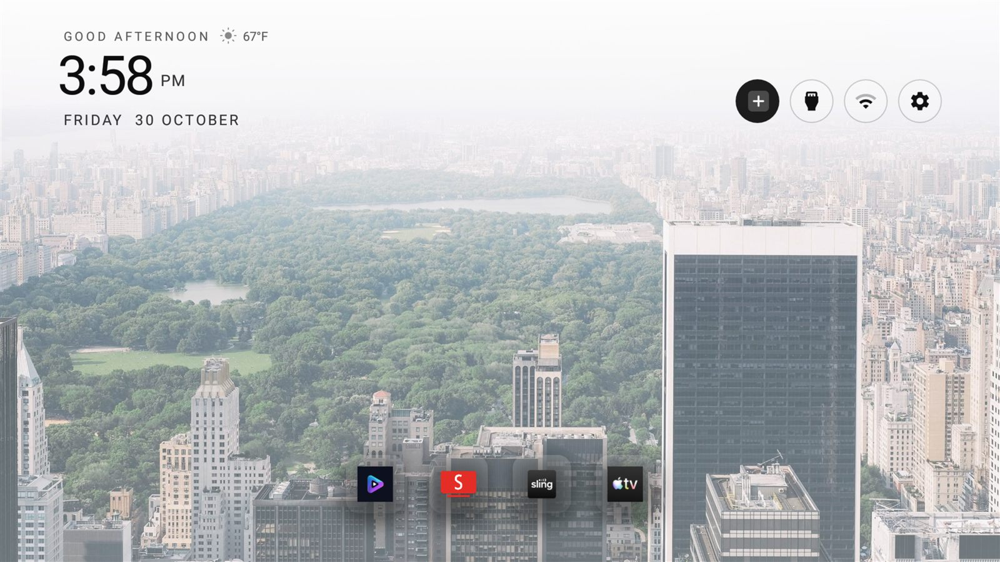
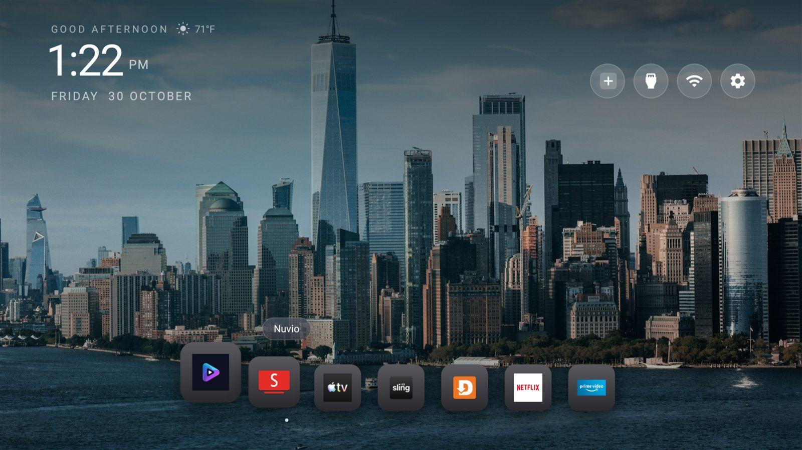
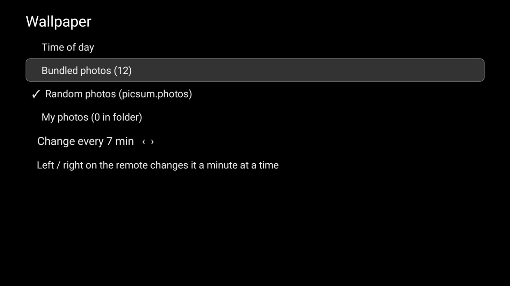
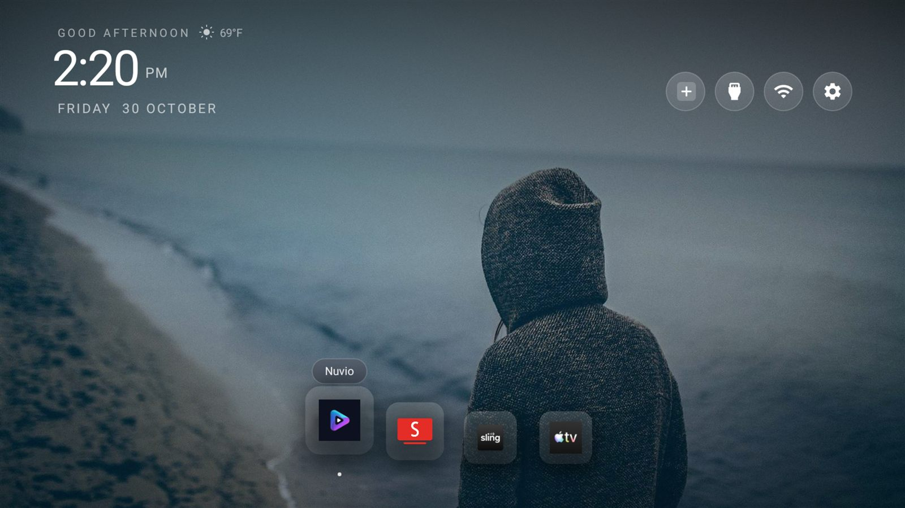
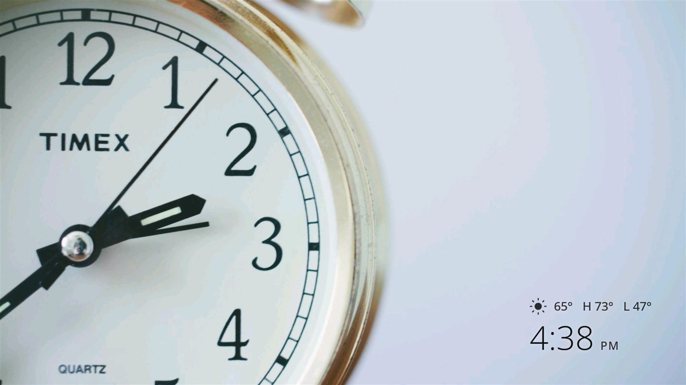
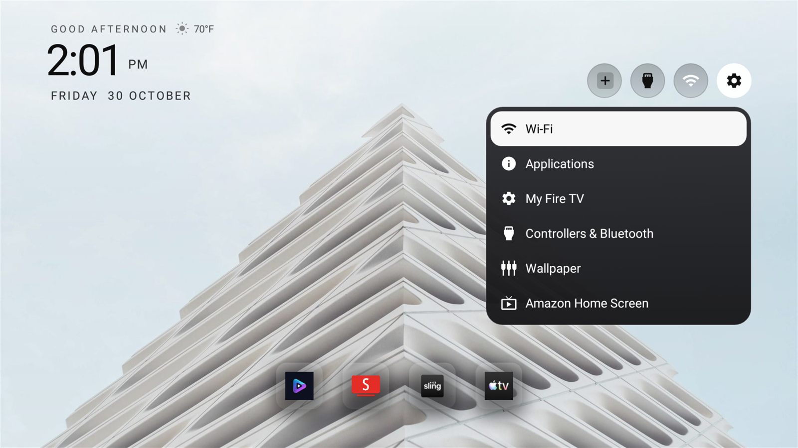
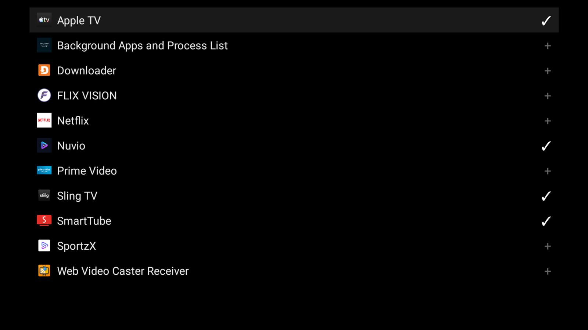

# Fire TV Home

A clean, ad-free home screen for Amazon Fire TV — no Amazon launcher, no sponsored rows, no
recommendation carousel. Built as a native Android launcher and tested on a **Fire TV Stick 4K
(1st gen, AFTMM) running Fire OS 6.7.1.1 / Android 7.1.2**, where Amazon's own launcher is
disabled-in-place and a lightweight TV home takes its place on the Home key.



## Why this exists

Amazon's Fire TV home is an advertising surface. The stock launcher cannot simply be replaced:
Fire OS ignores the default-home setting, refuses to bind third-party accessibility services, and
does not deliver `BOOT_COMPLETED` to sideloaded apps. This launcher works with those restrictions
instead of against them:

- **Home key** — a foreground service watches `logcat` for Amazon's home screen and raises this
  launcher with `AppTask.moveToFront()`. Lands in **well under a second**.
- **After a reboot** — a persisted `JobScheduler` job is rescheduled by the system and restarts the
  redirect, so the launcher comes back without any adb help.
- **Recovery** — the launcher also registers as a leanback app, so it can always be opened from the
  app list.

## Features

### A real dock, with a picker

The dock holds up to 12 apps and is edited on the TV: press **+** to tick apps in the order you want
them, or long-press a tile to pin, unpin or move it. Spacing is computed from the measured width, so
icons keep equal cells at any count instead of overlapping.



### Weather at a glance

Current conditions sit next to the greeting (Open-Meteo, no API key), with the location resolved once
from the network and cached. The screensaver adds today's high and low.

### Wallpapers that rotate

Choose a source in **gear → Wallpaper**:

| Source | What it is |
| --- | --- |
| Time of day | Four photos, swapped morning / afternoon / evening / night |
| Bundled | Twelve photos shipped with the app |
| Random | Any image from `picsum.photos` — no key, thousands of options |
| My photos | `.jpg` / `.png` files you push to the app's own folder |

Set how often it changes, one minute at a time. The screensaver follows both choices.



### Readable on any photo

Every wallpaper is sampled for average brightness, and the whole UI flips: dark text and icons over
bright photos, white over dark ones, with the scrim, the pill faces and the focus states all
matching.



### A screensaver that belongs to the same system

Same photo source, same interval, plus a large clock with AM/PM and today's weather — with the same
contrast switching.



### Settings that actually open

Fire OS sends `android.settings.SETTINGS` to a dummy handler and guards most screens with signature
permissions. The gear opens a popup with the screens that an app *can* start — Wi-Fi, Applications,
My Fire TV, Controllers & Bluetooth, Wallpaper — with Amazon's home as the escape hatch for the rest.





### Fewer ads

The repository ships `examples/amazon-fire-tv-stick-4k-1stgen-AFTMM/debloat.txt`: sixteen ad,
telemetry and unused-app packages, disabled per user (never uninstalled) with a restore script.

## Install (Fire OS 6)

1. On the TV: **Settings → My Fire TV → About**, select the device name seven times, then
   **Developer Options → ADB debugging → ON**.
2. Build and install:
   ```bash
   cd launcher
   echo "sdk.dir=/path/to/Android/Sdk" > local.properties
   ./gradlew assembleDebug
   adb connect <tv-ip>:5555
   adb install -r app/build/outputs/apk/debug/app-debug.apk
   ```
3. Grant the log access the redirect needs (survives reboots):
   ```bash
   adb shell pm grant com.gathin.tvhome android.permission.READ_LOGS
   ```
4. Use it as the screensaver, and start the redirect:
   ```bash
   adb shell settings put secure screensaver_components com.gathin.tvhome/com.gathin.tvhome.PhotoDream
   adb shell am startservice -n com.gathin.tvhome/.HomeRedirectService
   ```
5. Press **Home**. To go back to Amazon's home screen at any time, press **Menu** on the Settings
   pill and choose *Use Amazon Home Screen*.

Requires JDK 17+ and Android SDK platform 34. `minSdk` is 25 (Android 7.1).

## Remote controls

| Input | Action |
| --- | --- |
| Home | This launcher |
| D-pad / OK | Move and open tiles |
| Down from the dock | App grid |
| **+** pill | Pick dock apps |
| Gear pill | Settings popup |
| Menu on the gear | Toggle the Home redirect |
| Long-press a tile | Pin / unpin / move |

## Notes and limitations

- Home detection matches Amazon's ActivityManager log lines, so it is Fire OS 6 version-sensitive.
- The screensaver rotates on the wallpaper interval; at long intervals that is one photo per sleep.
- The UI strings are English only.
- Trademarked dock artwork is not included; icons come from each installed app.

## Credits

Built on [Gathin23/tv-vibehack](https://github.com/Gathin23/tv-vibehack) via
[itsmeterrylin/fire-tv-cleanup](https://github.com/itsmeterrylin/fire-tv-cleanup), which provides the
original launcher, screensaver and debloat tooling. Fire OS 6 support, weather, wallpaper sources,
contrast switching, the dock picker and the screensaver work in this repository were added on top.

MIT licensed — see [LICENSE](LICENSE).
